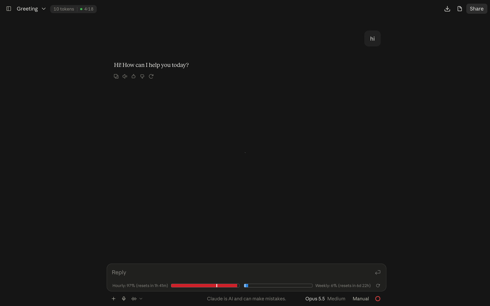
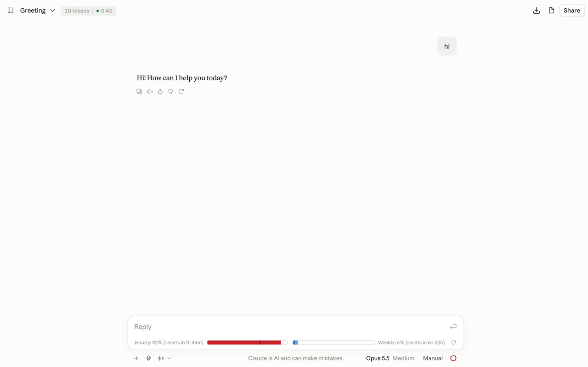
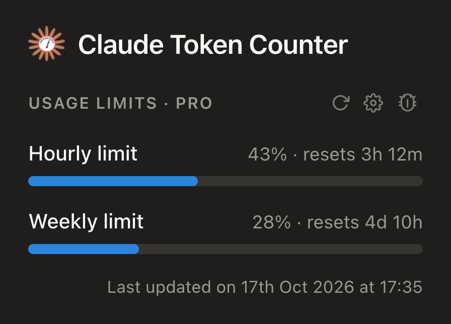
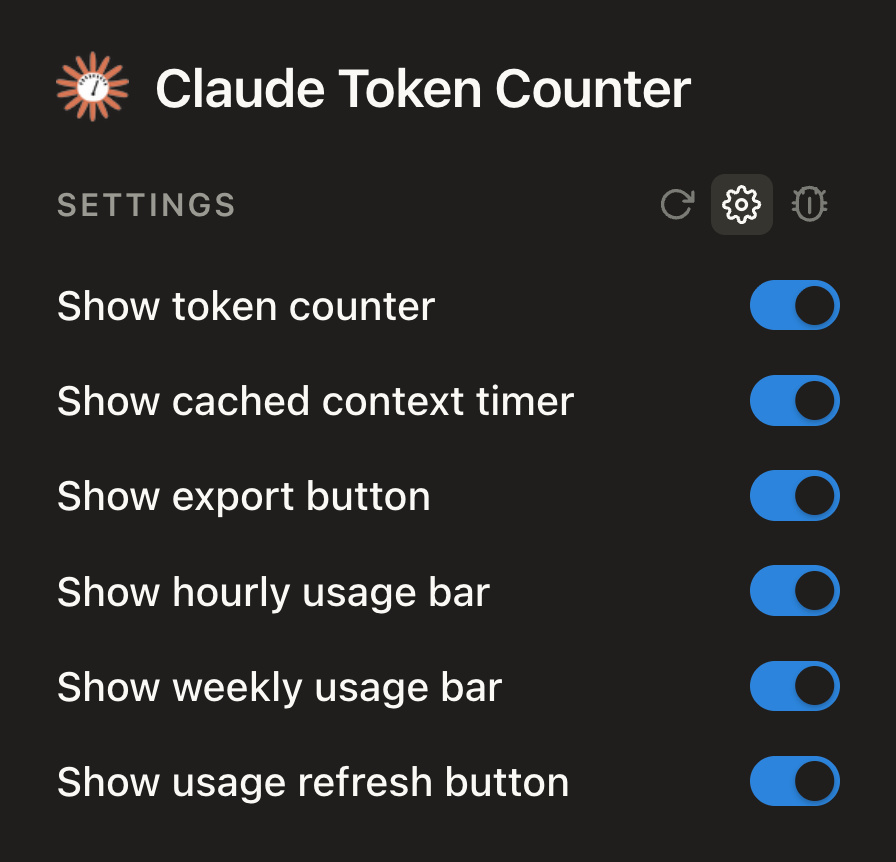
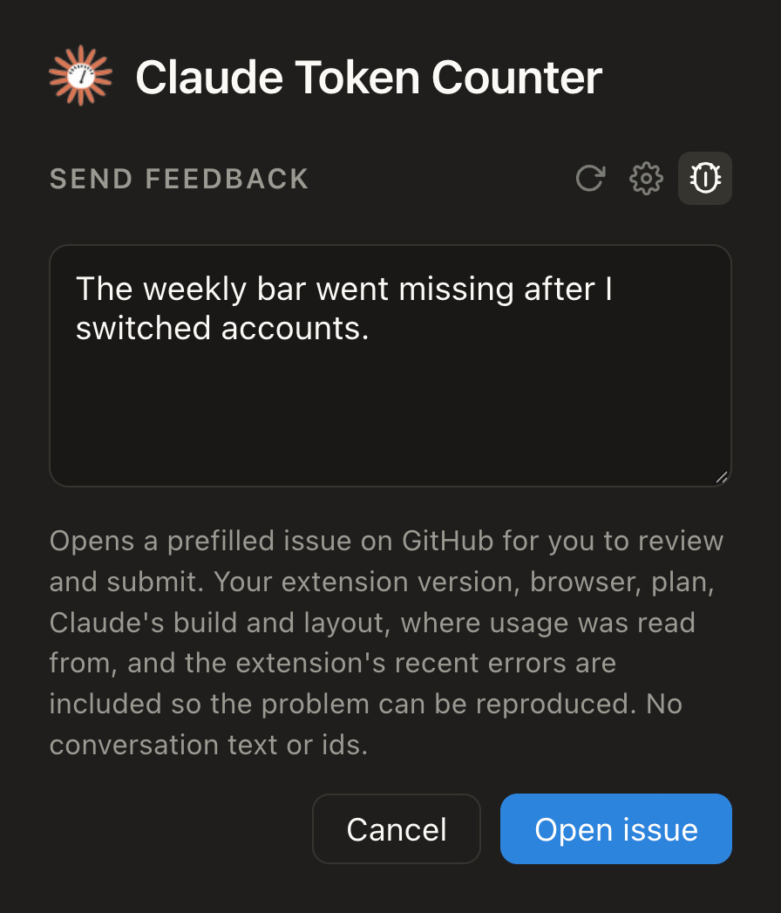

<p align="center">
  
</p>

<h1 align="center">Claude Token Counter</h1>

<p align="center"><b>A minimal browser extension that shows live token count, cache timer, and usage bars on claude.ai, exports any conversation to Markdown or plain text, and puts your plan limits one click away from any tab</b></p>

<p align="center">
  <a href="https://chromewebstore.google.com/detail/claude-token-counter/bioobpobpbeohjoefndgkiaakboimpch">
    
  </a>
  <a href="https://addons.mozilla.org/en-US/firefox/addon/claude-token-counter">
    
  </a>
</p>

https://github.com/user-attachments/assets/6e5276ac-5881-43a4-92d1-d4ca439bb60e

## Features

- **Token count**: approximate token count for the current conversation, shown in a quiet chip beside the chat title
- **Cache timer**: countdown in the same chip, an estimate of how long Claude keeps the conversation's context cached: five minutes from the last reply, the length of Anthropic's standard prompt cache (Anthropic does not publish how claude.ai itself caches). A green dot marks a running countdown, the dot is muted while a reply is awaited, and the timer disappears when the window closes
- **Usage bars**: session (5 hour) and weekly (7 day) usage from Claude's own data, with reset countdowns. Bars turn amber past 75% and red past 90%. A thin line marks how far through the window you are, so you can see whether you are burning quota faster than the clock
- **Hover help**: every control explains itself in a tooltip drawn to match Claude's own, and the token counter opens a small popover with each model's context-window size
- **Chat export**: download the current conversation as Markdown or plain text, including the text files Claude generated (binary ones are listed by name)
- **Toolbar popup**: click the extension icon from any tab for your plan's session and weekly limits, with settings for what appears on the page and a one-click bug report

The extension requests a single permission, `storage`. It runs on claude.ai and nowhere else, so that is the only site the browser lists it as able to access. The popup asks for its own access to claude.ai only if you press refresh there.

## Screenshots

| Dark | Light |
| --- | --- |
|  |  |

The toolbar popup: your limits from any tab, a switch for each part, and a prefilled bug report.

| Usage limits | Settings | Send feedback |
| --- | --- | --- |
|  |  |  |

## Installation

**Chromium** (Chrome, Edge, Brave, Opera, Vivaldi, Arc, and any other Chromium-based browser; version 111 or later)
1. Install directly from the [Chrome Web Store](https://chromewebstore.google.com/detail/claude-token-counter/bioobpobpbeohjoefndgkiaakboimpch). Works out of the box on Chrome, Brave, Vivaldi, and Arc. On Edge, turn on **Allow extensions from other stores** under `edge://extensions` first. On Opera, click **Add to Opera** on the listing page.
2. Or install locally: download the latest `claude-token-counter-chrome-*.zip` from the [Releases](../../releases) page, go to the browser's extensions page (`chrome://extensions` on Chrome, `edge://extensions` on Edge, `opera://extensions` on Opera, or the equivalent for your browser), enable **Developer mode**, and drag and drop the zip onto the page.

**Firefox** (requires Firefox 128 or later)
1. Install directly from [Firefox Browser Add-ons](https://addons.mozilla.org/en-US/firefox/addon/claude-token-counter).
2. Or, for testing, download the latest `claude-token-counter-firefox-*.zip` from the [Releases](../../releases) page, open `about:debugging#/runtime/this-firefox`, click **Load Temporary Add-on** and pick the zip. Firefox installs only signed add-ons permanently, and this zip is unsigned, so it is removed when Firefox restarts; use the Add-ons listing above to keep it.

## How it works

The extension has two halves that run in two different JavaScript worlds, because claude.ai's own page scripts and network requests aren't visible to a normal content script.

**1. The page-world bridge (`src/injected/bridge.js`)**

This script runs in the page's own execution context (the "main world"), not the isolated content script sandbox. The manifest declares it with `"world": "MAIN"` and `"run_at": "document_start"`, so it is in place before claude.ai's first script: claude.ai's network code keeps the `fetch` it finds, and a tap added later would see nothing it sends. It patches three things on `window`:

- `window.fetch`: every request claude.ai makes passes through here first. The bridge inspects the URL and response of each call:
  - POST requests to `/completion` or `/retry_completion` mark the start of a generation, which is used to show a "pending cache" state in the UI.
  - Responses with an `event-stream` content type are read via a `ReadableStream` reader, line by line, watching for a `data: {"type":"message_limit", ...}` payload. This is the same server-sent event stream Claude's own UI uses to update usage in real time, so the bars move as soon as a reply lands.
  - On the newer claude.ai layout there is no `/completion` stream: messages are sent with a Connect RPC (`PerformAction`) and everything comes back on a long-lived `StreamTimeline` stream in binary protobuf. The bridge reads a copy of that stream with a small decoder for exactly two things, the conversation's status (whose change from busy to idle is the end of a reply) and the same `message_limit` usage figures.
  - A send that claude.ai refuses for hitting the limit still reports usage in its error body, and that is read too.
  - Responses to `/chat_conversations/{id}?tree=...` are cloned and parsed as JSON, giving the extension the full message tree for the active conversation.
- `history.pushState` / `history.replaceState`: claude.ai is a single-page app, so navigating between conversations doesn't reload the page or fire a `popstate` event. The bridge wraps both methods to dispatch a custom `cc:urlchange` event whenever the app changes routes, which is how the extension knows to re-attach its UI and refetch data for the new conversation.

Because the bridge runs in the page's own world, it can't call extension APIs like `chrome.runtime`, and the content script can't call anything the bridge defines. The only channel between them is `window.postMessage`, tagged with a `cc: 'ClaudeCounter'` marker and matched by request ID for request/response pairs (used for on-demand usage, organisation and conversation fetches) or broadcast as one-way events (the generation start and end, the conversation tree when the page fetched it itself, the organisation id, and the usage-limit signals above).

**2. The content script (`src/content/*.js`)**

Runs in the isolated content script world, declared in `manifest.json` against `https://claude.ai/*`. It's responsible for everything user-facing:

- `bridge-client.js` listens for the bridge's `postMessage` events and sends it requests. The bridge was already running before it, so on load it says hello and the bridge repeats what it saw in the meantime (the organisation id).
- `main.js` orchestrates state: it tracks the current conversation ID (parsed from the URL path), the current org ID (read from the `lastActiveOrg` cookie, or learned from claude.ai's own requests through the bridge), and reacts to the bridge's events by kicking off token recomputation or usage refreshes. The UI re-attaches itself to claude.ai's own DOM anchors — the composer card and the chat header — whenever the SPA re-renders, from one throttled `MutationObserver` in `ui.js` (at most one search a second, with a retry when a batch lands inside that window).
- `tokens.js` turns a raw conversation payload into a token count. claude.ai stores every edit and every branch of a conversation in one flat `chat_messages` array; the extension walks backward from `current_leaf_message_uuid` via each message's `parent_message_uuid` to reconstruct just the active branch (the "trunk"). It strips out non-text content (thinking blocks, images, documents), serializes `tool_use`/`tool_result` blocks, and feeds the resulting text through a vendored `o200k_base` tokenizer (`src/vendor/o200k_base.js`). That is OpenAI's encoding, not Claude's own, so the count is approximate and reads lower than Claude's own, which also includes thinking, the system prompt and tools. After Claude compacts a conversation, the count starts from its summary. Counting costs a few tens of milliseconds even for a very long conversation, so every refresh counts the whole trunk afresh instead of caching.
- `ui.js` renders and updates the actual widgets: the token count and the cache countdown (based on the last assistant message's timestamp plus a 5 minute cache window) as one chip beside the chat title, the session/weekly usage bars, and the export button. Colours live in `styles.css` as custom properties that follow claude.ai's own light and dark mode, not in script, and tooltips, popovers and menus reuse Claude's own tooltip variables and measured dimensions. The usage row is anchored to the composer card (see below) so it sits inside the input box on both the home and conversation layouts.
- `export.js` turns a conversation payload into a Markdown or plain text document. It reuses the same trunk reconstruction as `tokens.js`, so an export contains the conversation as it currently reads, not the edited-away branches. Files Claude generated (`create_file`, and the older `artifacts` tool) are embedded in full, with every later `str_replace` edit replayed onto them so the exported file matches the version that was actually used. Tool calls collapse into a one-line summary rather than pages of JSON, and thinking blocks are excluded. The download uses a blob URL and an `<a download>` click, so no `downloads` permission is needed.

- `src/popup/*` is the toolbar popup and the settings panel. It is a separate document and cannot read the content script's memory, so the content script mirrors each usage reading into `chrome.storage.local` and the popup renders that snapshot, timestamped. It does load `src/content/constants.js`, so the storage keys, settings defaults and plan labels exist once and are shared. Pressing refresh asks for optional access to claude.ai and then reads `/api/organizations` and the usage endpoint directly, so the popup works on a fresh install without ever opening claude.ai in a tab.

**3. Usage bars specifically**

Usage numbers come from two sources that the extension reconciles:

- A REST call to `/api/organizations/{orgId}/usage`, fetched on demand through the bridge, which returns `five_hour` and `seven_day` utilization percentages plus their reset timestamps.
- The live `message_limit` event described above, from the SSE stream on the older layout or the timeline stream on the newer one, which carries the same figures as fractions (0.42 for 42%) and arrives with every reply, so the bars update without a page reload. Both sources report whole percentages (seen 2026-10-16), so the figures match claude.ai's own usage page.

The end of a reply is known from the stream (the SSE stream closing, or the timeline's conversation status going idle), and `main.js` also watches the page's own `data-is-streaming` flag as a second signal, so the count still moves if one of them changes. If a part of the extension cannot be painted for a few seconds because claude.ai's layout has no place for it, it floats over the page as a small pill instead of disappearing, and tries its real spot again every half minute.

A one-second interval (`tick()` in `main.js`, idle while the tab is hidden) keeps the countdowns moving, triggers an automatic refresh right after either window rolls over, and does a once-an-hour safety refetch if neither a reply's stream nor a manual refresh has updated the numbers recently.

Not every plan reports both sources. On the free plan the REST endpoint returns `null` for every window, so the `message_limit` event that accompanies a reply is the only source and usage is unknown until the first message of a session. The row says so rather than sitting blank, and once a reading arrives it is stored and shown again on later loads. A stored window whose reset has passed is dropped, since no active window exists until the next message; one that has not is still correct, because usage only advances when a message is sent, so it is a floor rather than a stale figure. A window with no current reading keeps its place marked with a dash instead of disappearing, so the row never collapses to a single bar.

Because the free plan's figures only ever arrive with a reply, they cannot reflect usage from another device until the next message is sent in that browser. Refresh in the popup cannot help there either, and says so instead of restamping an old reading as current. Paid plans read from the endpoint on every load, so they are always accurate across devices.

Each bar carries a thin line showing how far through its reset window the clock has travelled, which is what makes the fill readable: 40% used two hours into a five-hour window means something different from 40% used with ten minutes to go. Neither source states how long a window actually is, so its start is inferred by subtracting the nominal length from the reset time. That inference is checked rather than trusted — a window can never have meaningfully more time left than it is long, so a reading well above the nominal proves the figure wrong for that account and the line is withdrawn instead of pointing somewhere misleading. The margin matters: the reset time comes from Claude's clock and the comparison is against your browser's, so a window that has just opened reads as slightly over-long on any machine running a little behind. The bar, the percentage, and the countdown are unaffected.

The composer is located by `[data-cds="ChatComposer"]`, Claude's own design-system attribute, falling back to a `rounded-composer` class and then to shape: the nearest ancestor of the text input that is a flex column with a corner radius and a painted background. Claude ships more than one composer design and the class names differ between them.

Nothing here talks to any server other than claude.ai itself. There's no analytics, no telemetry, and no third-party network calls; all computation (tokenizing, rendering) happens locally in the browser. What is stored, and the boundaries the code enforces, are in [SECURITY.md](SECURITY.md); the privacy policy is [PRIVACY.md](PRIVACY.md).

## Exporting a conversation

Click the download icon in the top-right corner of a chat, just left of Claude's own controls (it moves with them as panels open), and pick **Markdown (.md)** or **Plain text (.txt)**. The file is built in the browser and saved straight to your downloads; nothing is uploaded anywhere. On a layout with no controls to sit beside, the button stays next to the token counter instead.

An export contains every message on the active branch, generated files in full, and one-line summaries of the tools Claude used. Alternate versions of edited messages, thinking blocks, and raw tool output are left out. Binary outputs such as `.xlsx` files live in Claude's sandbox rather than in the conversation, so they are referenced by name but cannot be embedded.

## The popup

Click the toolbar icon to see the 5-hour and weekly limits, plus a separate weekly bar for any model with its own allowance (Fable, on the plans that have one), and when the reading was taken. It works from any tab, not just claude.ai, because it renders a stored snapshot rather than live data. The bars use the same amber and red thresholds as the ones on the page, so a limit looks equally urgent wherever you notice it.

The refresh button fetches current numbers. The first press asks for access to claude.ai; declining leaves everything else working. The popup asks for nothing at install time.

The gear beside it opens settings, with a switch for each thing the extension adds to claude.ai: the token counter, the cached context timer, the export button, the hourly and weekly bars, and the usage refresh button. Everything is on by default, changes apply to open tabs immediately, and the preferences live in extension storage.

The bug icon opens a feedback box. Describe the problem and it opens a prefilled issue on this repository for you to review and submit. It deliberately does not file the issue itself: that would mean shipping a GitHub token inside the extension, where anyone could extract it. The report carries your extension version, browser, plan, Claude's build number, which layout was detected, which parts of the extension are showing on the page, where the last usage reading came from, any part that had to float, any settings you turned off, and the extension's last few error messages, and you see all of it before anything is sent.

## Development

There is no build step. Load the repository root as an unpacked extension and reload it after editing; content script changes need an extension reload, not just a page refresh.

```bash
npm ci --ignore-scripts   # ESLint only; the extension ships no runtime dependencies
npm test                  # every suite
npm run lint
```

The suites run the real content scripts in Node against a small DOM shim, so they exercise shipped code rather than a copy: the token and cache chip, the exporter, the popup, plan detection, the settings switches, the usage bars' elapsed-time markers, the two usage payload shapes, packaging, and a set of security guards that fail on `eval`, `innerHTML`, widened permissions, an unpinned GitHub Action, or a dependency that could execute code at install time.

One of them guards against features disappearing rather than misbehaving, which is a failure the others cannot see. `inventory.test.js` asserts what the UI is *made of* — every element exists, is attached, and has a style rule — and compares the rendered tree against a committed snapshot at `test/snapshots/ui-structure.txt`. Removing something is still allowed; it just has to be a visible edit to a list or a snapshot rather than a silent omission. Regenerate the snapshot deliberately with `UPDATE_SNAPSHOT=1 npm test`, and read the diff before committing it.

Anchoring and visual layout are the one thing the suites cannot reach — the DOM
shim has no layout, so it can prove an element exists but never that it is
painted. `test/fixtures/composer.html` covers that by hand: serve the repo
(`python3 -m http.server 8777`) and open it to see a real `CounterUI` attach to
all three composer variants and to a mock Claude header. It is not part of `npm test`; there is no browser
in CI.

## Releasing

Bump `version` in `manifest.json`, `package.json` and `package-lock.json` (the tests fail if they disagree) and push to `main`. If no `v<version>` tag exists yet, the workflow runs the tests and lint, creates the tag and release, builds the Chrome and Firefox artifacts, verifies nothing unwanted was packaged, and publishes them with a `SHA256SUMS.txt`. When the Chrome Web Store credentials are set as repository secrets it also uploads the Chrome zip to the store as a draft, which still needs **Submit for review** in the developer dashboard; without them that step is skipped and the zip is uploaded by hand. Releases are cut from `main` only, and pushing a tag by hand no longer does anything (a manual run from the Actions tab retries a failed release). Every action is pinned to a commit SHA. See [SECURITY.md](SECURITY.md) for the dependency policy.

## Credits

- Forked from [she-llac/claude-counter](https://github.com/she-llac/claude-counter)
- Token counting via [gpt-tokenizer](https://github.com/niieani/gpt-tokenizer) (MIT)
- Inspired by [Claude Usage Tracker](https://github.com/lugia19/Claude-Usage-Extension) by lugia19
